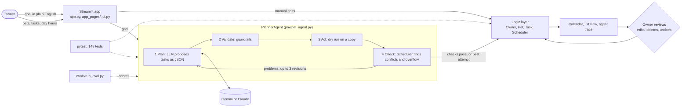

# PawPal+ — a pet-care scheduler with a self-checking AI planner

**Code:** https://github.com/BogCheese/A110-applied-ai-system-project · **Design and reflection:** [model_card.md](model_card.md) · **Diagram:** [diagrams/architecture.mmd](diagrams/architecture.mmd) · **Captured run logs:** [evals/sample_output.txt](evals/sample_output.txt)

**Original project (Modules 1-3): PawPal+.** The original PawPal+ was a Streamlit app that helped a busy pet owner plan daily care for their pets. The owner entered pets and care tasks (walks, feeding, meds, grooming), each with a duration and priority. A pure-Python scheduler then built a daily plan within the owner's available minutes and explained why each task was included or skipped. This final version keeps that scheduler and adds an AI planning agent, a reliability evaluation, and a redesigned multi-page interface.

## What it does and why it matters

You describe a goal in plain English, such as *"I just adopted a puppy, set up a daily care routine"*, and PawPal+ adds real, scheduled care tasks to your pets. It then shows them on a calendar and a checklist.

Language models are good at drafting plans and unreliable at making them *fit* (overlapping times, more minutes than the day has, invented pets). PawPal+ does not trust the model's own judgment. Every AI proposal is validated by guardrails, tried on a copy of your data, and checked by the same deterministic scheduler the rest of the app uses. Problems go back to the model for revision, and nothing touches your real data until the checks run. The point of the project is that pattern: **let the AI propose, let ordinary tested code verify, and keep a human in control.**

## Architecture overview

The full diagram is in [diagrams/architecture.mmd](diagrams/architecture.mmd); the class diagram is [diagrams/uml.mmd](diagrams/uml.mmd). A condensed view:



- **Input:** a plain-English goal, or manual pets, tasks, day hours and busy times.
- **Process:** `PlannerAgent` runs plan → validate → act on a copy → check → revise. The checks use `Scheduler.detect_conflicts()` and `Scheduler.generate_plan()`, so the verifier is ordinary code with its own tests, not the model.
- **Output:** a calendar and list view of today, plus a "What the agent did" trace listing each attempt, rejection and problem found.
- **Humans:** the owner reads the trace and the new tasks and can edit, delete, tick done or undo any task. Humans also read the eval report.
- **Automated checks:** pytest covers the logic, the agent (with a scripted fake model), the pages and the calendar. `evals/run_eval.py` replays fixed scenarios and scores each result with the scheduler.

| File | Role |
|------|------|
| `pawpal_system.py` | Data classes and the `Scheduler` (no Streamlit, no AI) |
| `pawpal_agent.py` | `PlannerAgent`, guardrails, Gemini and Claude clients behind one small `LLMClient` interface |
| `app.py`, `app_pages/`, `ui.py` | Streamlit entry point, three pages (Schedule, Plan with AI, Day & pets), shared helpers |
| `calendar_view.py` | Draws the calendar as HTML, tested without a browser |
| `evals/run_eval.py` | Reliability harness |
| `tests/` | 148 tests |

## Setup

Requires Python 3.10 or newer (developed on 3.13).

```bash
git clone https://github.com/BogCheese/A110-applied-ai-system-project.git
cd A110-applied-ai-system-project
python -m venv .venv
source .venv/bin/activate        # Windows: .venv\Scripts\activate
pip install -r requirements.txt
streamlit run app.py
```

Everything except the AI planner works with no key. To enable the planner:

1. Get a free Gemini key at https://aistudio.google.com/apikey.
2. Copy `.env.example` to `.env` and put the key in it (`GEMINI_API_KEY=...`). `.env` is git-ignored.
3. Restart the app.

To use Claude instead, run `pip install anthropic` and set `ANTHROPIC_API_KEY`. If both keys are set, choose with `PAWPAL_PROVIDER=gemini|anthropic`; override the model with `PAWPAL_MODEL`.

Other commands:

```bash
python main.py                  # the scheduler in the terminal, no UI
python -m pytest                # 148 tests, no network or key needed
python -m evals.run_eval        # offline reliability run (scripted model)
python -m evals.run_eval --live --repeats 3   # real model, needs a key
```

## Sample interactions

Reproduce the first three with one command (no API key needed; the full captured output is saved in [evals/sample_output.txt](evals/sample_output.txt)):

```bash
python -m evals.demo            # three goals, each with the agent's trace and the final schedule
python -m evals.demo --live     # same goals against the real model
```

The first three are real traces produced by the agent code. The model replies come from the offline eval's *scripted* model (`evals/run_eval.py`), which replays fixed answers so the checking and revision logic can be shown deterministically. A live Gemini run produces the same kind of trace with the model's own wording.

**1. The agent catches an overlap and fixes it**
Input: *"I just adopted a puppy, set up a daily care routine."* (pet: Biscuit, a dog; 120 minutes)

```
[plan]   Attempt 1: model proposed 3 task(s)
[check]  Conflict: Morning feeding (Biscuit, 8:00 AM-8:10 AM) overlaps Walk (Biscuit, 8:00 AM-8:30 AM)
[revise] Sending the problems back to the model to fix.
[plan]   Attempt 2: model proposed 3 task(s)
[check]  All checks passed: no new conflicts, everything fits.
[commit] Added 3 task(s) to your pets; all checks passed.

8:00 AM - 8:10 AM  Morning feeding (Biscuit)
8:30 AM - 9:00 AM  Walk (Biscuit)
6:00 PM - 6:10 PM  Evening feeding (Biscuit)
```

**2. The agent notices it planned more than the day allows**
Input: *"Care routine for my cat and dog, I only have 45 minutes a day."* (pets: Mia, Rex)

```
[plan]   Attempt 1: model proposed 3 task(s)
[check]  All tasks together take 110 min but the owner only has 45 min (over by 65). Shorten tasks or
         drop the lowest-priority ones. As it stands these would be left out: 'Long hike' (Rex).
[revise] Sending the problems back to the model to fix.
[plan]   Attempt 2: model proposed 3 task(s)
[commit] Added 3 task(s) to your pets; all checks passed.

8:00 AM - 8:10 AM  Feeding (Mia)
8:30 AM - 8:40 AM  Feeding (Rex)
5:00 PM - 5:20 PM  Short walk (Rex)         <- replaced the 90-minute "Long hike"
```

**3. A guardrail rejects an invented pet**
Input: *"Set up feeding for my dog Max."*

```
[plan]     Attempt 1: model proposed 1 task(s)
[validate] Rejected task 1 ('Feeding'): unknown pet 'Maxwell' (pets are: Max)
[revise]   Sending the problems back to the model to fix.
[plan]     Attempt 2: model proposed 1 task(s)
[commit]   Added 1 task(s) to your pets; all checks passed.

8:00 AM - 8:10 AM  Feeding (Max)
```

**4. No AI: the scheduler explains itself** (`python main.py`)
In the demo data, Buddy's morning walk overlaps Mia's breakfast. The app warns about the overlap, then the plan keeps higher-priority tasks at their preferred time and moves a clashing task to the next free slot, with a reason for each:

```
Conflict: Morning walk (Buddy, 7:00 AM-7:30 AM) overlaps Feed breakfast (Mia, 7:15 AM-7:25 AM)
...
- Give medication: high priority, placed at its preferred time 8:00 AM
- Feed breakfast: high priority, preferred time was taken or unavailable, placed in the next free slot
```

In the app, a task that could not go at the time it asked for is marked in the list, for example `8:25 AM – 8:45 AM · Playtime (Nala) · 🟢 Low priority · ⏱ wanted 5:25 PM`.

## Design decisions and trade-offs

- **The model proposes, ordinary code decides.** The checker is `Scheduler`, not a second model call. It is deterministic, free, fast and unit-tested, and the AI's mistakes show up as concrete messages (overlaps, minutes over budget) that the model can act on. *Trade-off:* the checker only knows about time. It cannot tell that a "feeding" task is a bad idea for a rabbit, so content quality is still the model's job and the human's review.
- **Dry run on a copy, commit at the end.** A failed or confused run leaves the owner's data untouched. If revisions run out, the best attempt is committed with its leftover issues shown to the user instead of hidden. *Trade-off:* the user may get a plan that is not fully clean, but they see exactly what is wrong.
- **Guardrails before the scheduler.** Unknown pets, bad durations, priorities and times are rejected up front and reported back to the model, so garbage never reaches the scheduler.
- **A greedy scheduler.** Tasks are placed by priority, then shorter first. It is easy to explain ("this was high priority, so it went first"), but it can choose a worse overall plan than the best possible one (a knapsack problem). For the handful of tasks one owner has, explainability wins.
- **Preferred times are soft, the time budget is hard.** A clash moves a task to the next free slot rather than dropping it, so a conflict can change *when* an important task happens but never *whether* it happens. Only task minutes count against the budget, not the 5-minute spacing between tasks.
- **A ticked task never moves.** Finished tasks stay on the plan, crossed out, in the slot they held when ticked. Without this, ticking a task made it jump to a different time and shuffled the others (a real bug found during use).
- **A small `LLMClient` interface** lets Gemini, Claude and a scripted fake model be swapped, which is what makes the agent testable offline.
- **Multi-page Streamlit app with a top navigation bar**, a dialog for editing, 12-hour time boxes in 15-minute steps, and segmented controls. *Trade-off:* Streamlit reruns the whole script on every interaction, so state is held in `st.session_state`, and data is lost on a browser refresh (no persistence yet).

## Testing summary

**148 automated tests, all passing** (`python -m pytest`, no network or API key needed):

| Area | Tests | What is covered |
|------|-------|-----------------|
| `tests/test_pawpal.py` | 50 | scheduling, priority, busy times, sorting, filtering, recurrence, conflicts, finished tasks |
| `tests/test_agent.py` | 29 | guardrails, revision loop, dry run and commit, duplicates, error handling, with a scripted fake model |
| `tests/test_app.py` | 55 | the Streamlit pages end to end (Streamlit's `AppTest`): adding, ticking, editing, time boxes, navigation |
| `tests/test_calendar_view.py` | 14 | the calendar drawing |

**Reliability eval** (`python -m evals.run_eval`): four scenarios, three runs each, every run scored on five checks (plan committed, no conflicts, fits the time budget, every pet covered, every dog/cat has a feeding task). The offline run scores **12/12**. That checks the harness and the revision loop, but it uses a scripted model, so it says nothing yet about how reliable the real model is. `--live` measures that. I have not recorded a live pass rate in this repo, so I make no claim about it.

**Reliability evidence** (text-based; reproduce with the commands above). Methods used: automated tests, an eval harness, and logging with error handling. Not used: confidence scoring (the model is not asked to rate its own certainty) and human evaluation (no peer review of live outputs has been done yet).

Offline eval, `python -m evals.run_eval` (scripted model, 3 runs per scenario, each run scored on the five checks above):

| Scenario | Evaluation criteria | Runs passed | Avg attempts | Same task count each run |
|----------|--------------------|-------------|--------------|--------------------------|
| new puppy | overlap is caught and revised away | 3/3 | 2.0 | yes |
| two pets, tight day | over-budget plan is caught and shortened | 3/3 | 2.0 | yes |
| weekly grooming | non-JSON reply is recovered from | 3/3 | 2.0 | yes |
| unknown pet guardrail | invented pet name is rejected | 3/3 | 2.0 | yes |
| **Overall** | all five checks | **12/12 (100%)** | | |

Failure handling, each covered by a named test in `tests/test_agent.py`:

| Input or condition | Expected behavior | Test | Result |
|--------------------|-------------------|------|--------|
| Empty goal, or no pets | Friendly error, data unchanged | `test_empty_goal_and_no_pets_rejected` | Pass |
| Model replies with prose, not JSON | Asked again, then recovers | `test_garbage_then_valid_reply_recovers` | Pass |
| Model never returns a valid plan | Error shown, owner unchanged | `test_never_valid_leaves_owner_unchanged` | Pass |
| API call crashes | Becomes a friendly `AgentError` | `test_llm_crash_becomes_agent_error` | Pass |
| Unknown pet, bad duration, priority or frequency | Item rejected with a reason | `test_validate_rejects_bad_items` | Pass |
| Two proposed tasks overlap | Problem sent back, plan revised | `test_conflict_is_sent_back_and_revised` | Pass |
| Plan needs more minutes than the day has | Reported once with the numbers, revised | `test_total_over_budget_is_reported_once_with_the_numbers` | Pass |
| Problems remain after the last revision | Shown to the user, not hidden | `test_unresolved_problems_are_reported_not_hidden` | Pass |
| Model repeats a task the pet already has | Skipped as a duplicate | `test_same_title_and_time_is_skipped_as_duplicate` | Pass |
| Gemini busy or rate limited | Retried automatically | `test_gemini_retries_then_succeeds` | Pass |

Summary: 148 of 148 automated tests pass, and the offline eval passes 12 of 12 runs. The agent needed a second attempt on every offline scenario, which is by design (each scenario starts with a flawed reply), so the checker did its job each time. Every agent run is recorded in `pawpal.log` (goal, attempts, rejected items, problems, outcome). Because the offline model is scripted, these numbers prove the checking and revision logic works; they do not measure the real model, which `--live` does.

**What worked**
- Testing the agent with a scripted model made the loop easy to test, including the failure paths (bad JSON, unknown pet, API error).
- Driving the real Streamlit pages with `AppTest` caught UI bugs that logic tests could not.

**What did not, and what I fixed**
- Completing a repeating task twice created duplicate copies; a task that was not yet due could be completed forever to spawn more. Both are now blocked, and un-ticking removes the copy it made.
- A cleared optional time box silently reverted to its default (Streamlit returns the `value=` default when a box is emptied), so a task's time could not be removed. Found by a failing test and fixed by seeding the value through session state.
- A ticked task jumped to its preferred time and displaced others. Fixed by recording the slot it held when ticked.
- Plans could look fine but not fit the buffer between tasks, while the conflict warning only checks overlaps. I now mark tasks that did not get the time they wanted rather than changing the warning.

**What I learned:** most "AI bugs" were really plain-code bugs at the edges (state, ordering, defaults), and the verifier is the part worth the most tests.

**Not tested:** month and year rollover of recurring dates, tasks that cross midnight, and screen-reader behavior (the UI was reviewed against WCAG 2.1 AA but not tested with a real screen reader).

## Portfolio: what this project says about me as an AI engineer

I treat a language model as an unreliable component, not an oracle. In PawPal+ I built the structure that makes it usable: a strict output format, guardrails, a dry run on a copy of the data, a verifier made of ordinary tested code, a bounded revision loop, logging, and an eval harness. I also write down what my evidence does and does not show: the offline eval passes 12/12, but it uses a scripted model, so it validates the loop and not the real model. I am comfortable with the full path from a design diagram to a tested, deployed-quality app, and I care more about being able to show that a system works than about a demo that merely looks good.

## Features at a glance

- Multiple pets in one schedule; priority-based greedy plan with a reason for every scheduled or skipped task
- Preferred times with fallback; busy times (e.g. work) and a day start and end; a time budget in minutes
- Conflict warnings; sorting by time; filtering by pet and status; daily and weekly recurrence with undo
- Calendar view (one colour per pet) and a list view with checkboxes; edit and delete from a dialog; night mode
- AI planner with guardrails, dry run, scheduler checks, up to 3 revisions, a visible trace and `pawpal.log` logging

## Reflection

Building PawPal+ taught me that adding AI to an app is mostly an engineering problem around the model, not inside it. The model's output is useful but cannot be trusted as it arrives, so the work was in the structure around it: validate it, try it on a copy, check it with deterministic code, feed back concrete errors, and leave the final call to a person. It also taught me to measure the model instead of trusting it, which is why the project has an eval harness and why this README says plainly what the offline eval does and does not show.

The graded responsible-AI reflection (how I worked with AI, a suggestion I accepted and one I rejected or revised, and the system's limitations) belongs in `model_card.md`. There is a short design reflection in [reflection.md](reflection.md).
